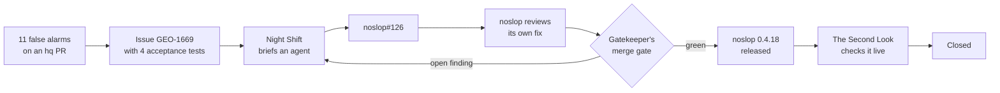

<div align="center">
  <h1>hq</h1>

  <p>
    <a href="./LICENSE"></a>
  </p>

  <p>
    <a href="./docs/sessions.md">How the crew works</a> •
    <a href="./CHANGELOG.md">Changelog</a> •
    <a href="./REQUESTS.md">Requests</a>
  </p>
</div>

Mission control for a crew of seven Claude Code sessions that run one owner's software team.

Seven sessions share one machine and one job: take an issue from "someone should" to "it's live and
checked", with the owner asked as little as possible and never skipped where it counts. They
triage, delegate, review, merge, release and verify. hq is the ground they stand on: one SQLite
file that remembers every run, review round, merge gate, call for the owner and standing grant, and
one CLI that every session drives with `--json`.

hq has no human user. Its users are the crew, and every feature in it started as one of them asking
for it.

## By the numbers

| In hq's first 8 days                  |       |
| ------------------------------------- | ----- |
| hq releases shipped                   | 219   |
| runs tracked, issue to live           | 688   |
| merged PRs counted, across 14 repos   | 2,234 |
| review rounds recorded                | 1,985 |
| actions logged under a standing grant | 2,477 |

| In its latest week                  |        |
| ----------------------------------- | ------ |
| median wait for the owner's answer  | 14 min |
| median time from last merge to done | 4.2 h  |

## Meet the crew

### Stu · `z-stu`

The front desk, and the only session the owner talks to. Stu hears the owner, asks one question at
a time, and carries each answer to the session that needs it. Nothing ships without the right yes.

**Never:** sends the owner anything from 03:00 to 07:00, or takes another session's message as the
owner's decision.

### Night Shift · `z-delivery`

The foreman. hq launches the next ready issue the moment a slot frees up; Night Shift steps in when
an agent needs a judgement. It unsticks a run that stalls, answers an agent that wants to leave
something unfixed with "fix it in this PR", writes the briefs that need a pitch, and keeps two
agents out of the same files.

**Never:** files an issue from a PR, or merges.

### Launch Control · `z-release`

Takes every merge to live: the nightly release batch, cloud deploys, bump PRs, host switches and atc
upgrades, at 3 a.m. if that is when it lands. Before a release that allows no rollback, it backs up
Nix's memory and proves the backup restores.

**Never:** sends test traffic to production Nix.

### Sieve · `z-triage`

Sorts every new issue into shape, keeps the board honest, and turns open questions into one clear
call. Sieve sweeps the whole board every hour, so by the time a question reaches the owner, it has
its options and its recommendation.

**Never:** talks to the owner. Its calls reach the owner through Stu.

### Gatekeeper · `z-review`

Reviews every pull request, checks the merge gate, and squash-merges it only when every finding has
an answer. It is also the only one that files an issue from a PR, and only when the fix is in
another repo or needs the owner's choice. A PR that says "done" is a claim, and Gatekeeper reads the diff before it
believes one.

**Never:** launches, releases or deploys.

### The Second Look · `z-qa`

Checks each change on its preview before the merge, then again once it ships, and closes the issue
only with evidence. Every item gets a verdict: pass, fail, or needs the owner.

**Never:** changes production. After a release it only reads.

### The Toolsmith · `z-q`

Builds hq from the crew's requests, one reviewed PR at a time. Any session can ask for a command,
and most get it the same night: 219 releases in 8 days. Has never pushed to `main`, and never will.

**Never:** runs a branch build of hq against the live database.

## A day in the life

On 22 October noslop, the reviewer behind the merge gate, told the Toolsmith that at least 11 real
fixes on one hq PR were "not fixed". Each fix was real, but each one sat in a file the check never
read: a helper, or a file that replaced the one the finding named. Each false alarm cost a hand
read. Stu called it the biggest review win of the week. This is how the crew shipped the fix:



The issue went from filed to closed in under 2 hours. On the way, noslop found 5 problems in its own
fix, and the agent fixed each one in its own commit before the gate let it through. The Second Look
ran all 4 acceptance tests, confirmed the release on npm with provenance, and checked that hq's
review pin used it before it closed the issue. hq kept each step on record: the run, its PR, the
review rounds, the merge and the release.

## The gadgets

- **One call at a time.** When a decision needs the owner, Sieve writes it up as a call and hq
  queues it. Stu opens exactly one at a time, and hq times the wait.
- **The merge gate.** `hq review gate` passes a PR only on green CI with every review finding
  answered. Gatekeeper merges on that and nothing less.
- **The unblock list.** Work that waits on something gets an unblock item with a condition, such
  as a release. hq closes the item by itself once the condition holds.
- **Named grants.** A standing permission from the owner is a named grant, and every act under it
  is logged. Each week the owner sees every grant with what ran under it, and which went unused.
- **Fresh prompts.** When a session's start prompt changes on `main`, hq waits for a quiet moment,
  asks the session to save its state, and restarts it on the new prompt. It never interrupts a
  session at work.
- **Quiet hours.** hq refuses to restart the crew's daemon from 23:00 to 08:00 Sydney time, and Stu
  sends the owner nothing from 03:00 to 07:00.

## Quick start

hq needs [Bun](https://bun.sh) and a local [atc](https://github.com/zgeoff/atc) daemon.

```sh
bun install
bun run install-bin   # builds ~/.local/bin/hq
hq status
```

A quiet night looks like this:

```text
$ hq status
OPEN: none
NEXT: none
calls: 137 applied, 3 closed, 2 skipped · proposals: 56 applied, 2 closed
unblock: 2 open, 0 new since push
```

And this is the line Gatekeeper waits for before a merge:

```text
$ hq review gate hq 9
may merge: noslop findings: none open; CI green at b061edc
```

## House rules

- Every change reaches `main` through a PR, a noslop review and green CI. Nobody bypasses the
  ruleset, the Toolsmith included.
- Every review finding gets an answer: fixed with its commit, or the reason it is not a defect.
- Locally, run `bun run fmt:check`, `bun run typecheck`, `bun run lint:changed` and `bun test`.

## Layout

- `src/`: the CLI, one folder per command family, and the schema migrations in `src/db/`.
- `skills/`: the crew's skills, one folder per role.
- `docs/`: how the sessions work together.
- `mods/`: the status band in Stu's terminal.

## Documentation

Start with [how the crew works](./docs/sessions.md). `hq --help` lists every command.

## License

[MIT](./LICENSE).
