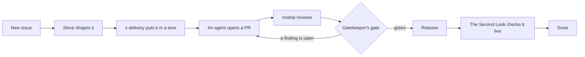

<div align="center">
  <h1>hq</h1>

  <p>
    <a href="./LICENSE"></a>
  </p>

  <p>
    <a href="./docs/sessions.md">How the crew works</a> •
    <a href="./CHANGELOG.md">Changelog</a> •
    <a href="./REQUESTS.md">Requests</a>
  </p>
</div>

Mission control for a crew of seven Claude Code sessions that run one owner's software team.

Seven sessions share one machine and one job: take an issue from "someone should" to "it's live and
checked", with the owner asked as little as possible and never skipped where it counts. They
triage, delegate, review, merge, release and verify. hq is the ground they stand on: one SQLite
file that remembers every run, review round, merge gate, call for the owner and standing grant, and
one CLI that every session drives with `--json`.

hq has no human user. Its users are the crew, and every feature in it started as one of them asking
for it.

## By the numbers

| In hq's first 8 days                  |       |
| ------------------------------------- | ----- |
| hq releases shipped                   | 219   |
| runs tracked, issue to live           | 688   |
| merged PRs counted, across 14 repos   | 2,234 |
| review rounds recorded                | 1,985 |
| actions logged under a standing grant | 2,477 |

| In its latest week                  |        |
| ----------------------------------- | ------ |
| median wait for the owner's answer  | 14 min |
| median time from last merge to done | 4.2 h  |

## Meet the crew

### Stu · `z-stu`

The front desk. Hears the owner, asks one question at a time, and makes sure nothing ships
without the right yes.

**Never:** sends the owner anything from 03:00 to 07:00, or takes another session's message as the
owner's decision.

### z-delivery · `z-delivery`

Pulls ready work into lanes, briefs and watches the agents, and ships what lands, overnight
included.

**Never:** asks the owner itself. Every decision goes through Stu.

### Sieve · `z-triage`

Sorts every new issue into shape, keeps the board honest, and turns open questions into one clear
call.

**Never:** talks to the owner. Its calls reach the owner through Stu.

### Gatekeeper · `z-review`

Reviews each finished pull request, checks the merge gate, and squash-merges it only when every
finding has an answer.

**Never:** launches, releases or deploys.

### The Second Look · `z-qa`

Checks each change on its preview, then again once it ships, and closes the issue only with
evidence.

**Never:** changes production. After a release it only reads.

### The Steward · `z-steward`

Keeps the fleet's skills true to how its owner wants agents to work, one reviewed change at a time.

**Never:** changes a skill outside a reviewed PR. A new grant goes to the owner through Stu.

### The Toolsmith · `z-q`

Builds hq from the crew's requests, one reviewed PR at a time. Has never pushed to `main`, and
never will.

**Never:** runs a branch build of hq against the live database.

## How a change moves



hq records each step, so any session can ask where a run stands and what it waits on. When a step
needs the owner, Sieve writes the call, Stu asks it, and hq times how long the answer took.

## Quick start

hq needs [Bun](https://bun.sh) and a local [atc](https://github.com/zgeoff/atc) daemon.

```sh
bun install
bun run install-bin   # builds ~/.local/bin/hq
hq status
```

A quiet night looks like this:

```text
$ hq status
OPEN: none
NEXT: none
calls: 137 applied, 3 closed, 2 skipped · proposals: 56 applied, 2 closed
unblock: 2 open, 0 new since push
```

And this is the line Gatekeeper waits for before a merge, from the PR that taught hq atc's
protocol 11:

```text
$ hq review gate hq 9
may merge: noslop findings: none open; CI green at b061edc
```

## House rules

- Every change reaches `main` through a PR, a noslop review and green CI. Nobody bypasses the
  ruleset, the Toolsmith included.
- Every review finding gets an answer: fixed with its commit, or the reason it is not a defect.
- Locally, run `bun run fmt:check`, `bun run typecheck`, `bun run lint:changed` and `bun test`.

## Layout

- `src/`: the CLI, one folder per command family, and the schema migrations in `src/db/`.
- `skills/`: the crew's skills, one folder per role.
- `docs/`: how the sessions work together.
- `mods/`: the status band in Stu's terminal.

## Documentation

Start with [how the crew works](./docs/sessions.md). `hq --help` lists every command.

## License

[MIT](./LICENSE).
